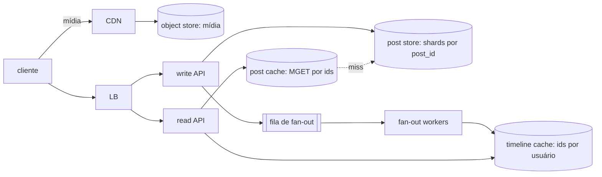
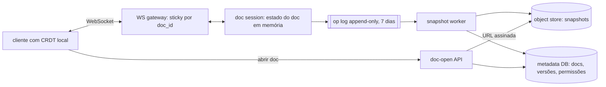
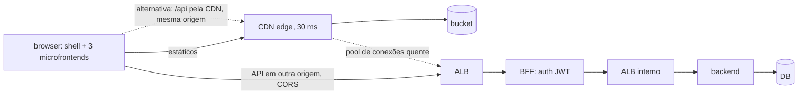

# Lab 02 — Back-of-the-envelope estimation (cap. 2)

Status: números de latência medidos (host, container, rede com latência injetada), previsão de teto do lab 01 a partir de custo unitário comparada com rampa, orçamento de latência, disponibilidade com chaos real, e estimativas com rascunho de arquitetura para três sistemas (feed, editor colaborativo, backoffice B2B) na seção 3.

Pergunta do lab: **uma estimativa feita com números medidos prevê o que o sistema aguenta? Onde ela erra?**

---

## 1. O que o livro propõe (resumo)

Estimar capacidade com contas simples: potências de 2 (unidades), números de latência de operações comuns (memória, disco, rede), disponibilidade em "noves" e um exemplo (Twitter: QPS de escrita, pico, storage de mídia em 5 anos). Dicas: arredondar, escrever premissas, rotular unidades. Processo importa mais que precisão.

O livro para na conta. O lab mede as constantes desta máquina e confronta a conta com o lab 01.

---

## 2. Experimentos e resultados

Como reproduzir:
```bash
cd labs/02-back-of-envelope
node bench/local.ts                                          # CPU / memória / disco no host
docker compose up -d --build --wait server redis postgres toxiproxy
docker compose run --rm bench node net.ts                    # rede, Redis, Postgres em 4 distâncias
docker compose run --rm --no-deps bench node fanout.ts       # custo do fan-out e da leitura de timeline no Redis
docker compose run --rm -e LABEL=docker-linux bench node local.ts
scripts/unit-cost.sh lb 3000 read                            # custo unitário no lab 01 (sobe o lab 01)
scripts/chaos.sh kill-api | pause-api | stop-pg              # falha no T+20s, desfaz no T+40s
node estimate.ts                                             # calibração: lê results/
node systems.ts                                              # estimativas por sistema (seção 3)
node stages.ts                                               # custo por estágio do cap. 1 (lab 01), preços em prices.ts
```

### E1 — Números de latência desta máquina

`bench/local.ts`, mediana de 5–7 rodadas após aquecimento. Host = Windows 11, Node 26. Container = Linux do WSL2, Node 24. Referência = visualização de 2020 dos números de Jeff Dean (citada no livro), valores aproximados.

| operação | referência (~2020) | host | container | comentário |
|---|---|---|---|---|
| leitura aleatória, set de 16 KB (L1) | ~1 ns | 1.3 ns | 1.4 ns | bate |
| leitura aleatória, 512 KB (L2) | ~4 ns | 4.9 ns | 4.7 ns | bate |
| leitura aleatória, 6 MB (L3) | ~10–20 ns | 76 ns | 108 ns | inclui miss de TLB (páginas de 4 KB); CPU híbrida (P/E-cores) |
| leitura aleatória, 256 MB (DRAM) | ~100 ns | 171 ns | 256 ns | TLB + VM do WSL |
| ler 1 MB sequencial da memória | ~3 µs | 99 µs | 116 µs | loop em JS (~10 GB/s), não `memcpy`: o número mede o runtime, não a RAM |
| `JSON.parse` | — | 2.0 ms/MB | 3.7 ms/MB | |
| `JSON.stringify` | — | 2.2 ms/MB | 3.0 ms/MB | |
| sha256 | — | 0.56 ms/MB | 0.59 ms/MB | |
| gzip nível 1 / 6 | — | 8.6 / 14.9 ms/MB | 8.1 / 14.6 ms/MB | razão 3.6× / 3.8× em JSON |
| brotli q4 | — | 12 ms/MB | 14 ms/MB | 3.8× |
| zstd padrão | — | 4.7 ms/MB | 3.6 ms/MB | 3.8×: mesma razão do gzip 6 com 1/4 da CPU |
| gunzip | — | 2.6 ms/MB | 2.9 ms/MB | descomprimir ~5× mais barato que comprimir |
| verificar JWT HS256 (HMAC) | — | 2.4 µs | 3.2 µs | |
| verificar JWT RS256 (RSA-2048) | — | 20 µs | 23 µs | 10× HMAC, ainda ~0.02 ms |
| write 4 KB + fsync | — | 0.31 ms | 1.5 ms | custo de um commit durável; NTFS × ext4 em VHDX |
| escrita sequencial | ~1 GB/s (SSD) | 1.1 GB/s | 1.0 GB/s | |
| leitura aleatória 4 KB (page cache) | 16 µs (SSD real) | 5.3 µs | 1.1 µs | é syscall + cópia, não disco: arquivo está no cache do SO |
| volta do event loop (`setImmediate`) | — | 0.8 µs | 0.9 µs | |

Lições:
- **Hierarquia de memória bate com o livro até L2.** De L3 para baixo, TLB e virtualização pesam: em VM e com páginas pequenas, "acesso à memória" custa 2–3× o número de livro.
- **Os números de livro são do hardware; o que a aplicação paga é do runtime.** Ler 1 MB "da memória" custa 3 µs em C e 100 µs num loop de JS. Para estimar, meça na linguagem e no ambiente que vão rodar.
- **Serialização e compressão custam ms por MB, não µs.** Uma resposta de 1 MB custa ~3 ms de `stringify` + ~15 ms de gzip 6 no servidor e ~3 ms de parse no cliente. Para uma API com respostas de 10 KB, isso é ~0.2 ms: some na rede. zstd/gzip 1 dão quase a mesma razão com muito menos CPU.
- **Criptografia de request é barata.** JWT RS256 custa 0.02 ms: não é gargalo de BFF.
- **fsync é a constante que mais muda entre ambientes** (0.3 ms no host, 1.5 ms no container, ~1 ms em EBS gp3, mais em Multi-AZ). Ele define o teto de commits/s por conexão sem group commit.
- Variância: uma segunda rodada no host deu 432 µs para "ler 1 MB do page cache" (primeira: 162 µs). Windows + CPU híbrida + turbo. Rodar 3× e olhar a mediana.

### E2 — Rede: o custo é contado em round trips

`bench/net.ts`. Cliente e alvos em containers. Quatro distâncias: `direct` (bridge do Docker), `proxy` (toxiproxy sem atraso, isola o custo do proxy), `az` (+1 ms RTT, ~duas AZs) e `region` (+110 ms RTT, ~São Paulo → us-east-1). p50 em ms (p99 em `results/net-docker.txt`).

| medição | direct | proxy | az (+1) | region (+110) | round trips |
|---|---|---|---|---|---|
| TCP 1 byte, socket aberto | 0.10 | 0.24 | 1.5 | 111 | 1 |
| HTTP GET keep-alive | 0.27 | 0.45 | 1.9 | 112 | 1 |
| HTTP GET conexão nova | 1.4 | 2.6 | 3.5 | 114 | 1 (*) |
| TLS 1.3 handshake | 3.0 | 4.5 | 5.6 | 117 | 1 (*) |
| HTTPS GET conexão nova | 4.2 | 6.3 | 8.4 | 231 | 2 (*) |
| HTTPS GET keep-alive | 0.36 | 0.69 | 2.0 | 112 | 1 |
| Redis GET | 0.09 | 0.33 | 1.9 | 112 | 1 |
| Redis 10 GETs em série | 1.3 | 3.0 | 18 | 1110 | 10 |
| Redis 10 chaves, `MGET` / pipeline | 0.10 / 0.13 | 0.48 / 0.46 | 1.6 / 1.7 | 111 / 111 | 1 |
| PG conexão nova (SCRAM) | 8.9 | 9.4 | 12 | 400 | ~3.6 |
| PG `SELECT 1` | 0.08 | 0.31 | 1.6 | 112 | 1 |
| PG SELECT por PK | 0.21 | 0.49 | 1.8 | 112 | 1 |
| PG INSERT + commit | 1.1 | 1.0 | 2.4 | 113 | 1 |
| PG 10 linhas, N+1 | 2.8 | 3.8 | 20 | 1120 | 10 |
| PG 10 linhas, `= ANY($1)` | 0.37 | 0.53 | 1.8 | 112 | 1 |

(*) O toxiproxy aceita o TCP localmente e só atrasa dados, então o handshake TCP não aparece. Na rede real, some 1 RTT em toda conexão nova: HTTPS novo = 3 RTT (TCP + TLS 1.3 + request), ~340 ms a 110 ms de RTT.

Lições:
- **Longe, latência = round trips × RTT, e o resto some.** A 110 ms, SELECT 1 e SELECT por PK custam o mesmo. Otimizar a query economiza 0.1 ms; tirar um round trip economiza 110 ms.
- **N+1 é invisível perto e fatal longe.** 10 queries: 2.8 ms no mesmo host, 20 ms entre AZs, 1.1 s entre regiões. `MGET`, pipeline e `= ANY` custam 1 round trip em qualquer distância.
- **Conexão nova é cara em qualquer distância.** No mesmo host, TLS custa 3 ms de CPU (ECDHE + assinatura) e uma conexão PG custa 9 ms (fork do backend + PBKDF2 do SCRAM). Longe, a conexão PG custa ~3.6 RTT. Por isso existem pool, keep-alive, RDS Proxy e PgBouncer.
- **TLS resumido não ficou mais rápido.** No TLS 1.3, resumir sem 0-RTT ainda custa 1 RTT e ECDHE; só economiza a verificação do certificado. O ganho real vem de não fechar a conexão.
- **Cada hop de proxy custa ~0.15–0.3 ms** (direct × proxy). É o mesmo ~0.8 ms do LB medido no E2 do lab 01.
- **Ponte com o caso C (seção 3):** um BFF a ~110 ms do usuário paga TCP + TLS + preflight + request = 4 RTT ≈ 440 ms antes do server time. Esta tabela mostra que cada parcela é 1 RTT.

### E3 — Prever o teto do lab 01 a partir do custo unitário

Método de envelope "de verdade": medir CPU por request em carga baixa e dividir os cores disponíveis por esse custo. `scripts/unit-cost.sh` roda o lab 01 em taxa constante e lê do Prometheus a CPU de cada container ÷ rps. Depois, uma rampa no mesmo dia mede o teto real. `node estimate.ts` monta a tabela.

| estágio | medido em | papel (limite) | CPU-ms/req | teto previsto | teto medido hoje | lab 01 (outro dia) |
|---|---|---|---|---|---|---|
| single | 1000 rps | API (1 core) | 0.59 | **1.7k** | ~2.0k (API em 1.0 core) | 2.3–2.5k sustentado |
| | | PG (2 cores) | 0.47 | 4.2k | | |
| lb | 3000 rps | API (4) | 0.92 | 4.3k | **3.3k média, 4.2k pico** | 5.4k pico |
| | | PG (2) | 0.57 | 3.5k | | |
| | | nginx (1) | 0.33 | **3.1k** | | |
| cache | 3000 rps | API (4) | 0.75 | 5.4k | **5.1k média, 7.5k pico** | 7.8k pico |
| | | PG (2) | 0.12 | 16k | | |
| | | nginx (1) | 0.32 | **3.2k** | (nginx saturado) | |
| | | Redis (1) | 0.11 | 9.5k | | |

Custo unitário cai com a carga (estágio single):

| API rps | API CPU-ms/req | PG CPU-ms/query |
|---|---|---|
| 494 | 0.84 | 0.56 |
| 1000 | 0.59 | 0.47 |
| 1990 | 0.50 (saturado) | 0.38 |

Ajuste linear `cores = fixo + marginal × rps` com os dois pontos baixos: 0.25 core fixo + 0.34 ms/req, teto 2.2k rps. Bate com o medido.

Lições:
- **A estimativa acerta a ordem de grandeza e o conjunto de suspeitos.** No `lb`, o modelo previu API, PG e nginx todos entre 3.1k e 4.3k. Na rampa os três saturaram juntos. No `cache`, previu nginx primeiro: foi o nginx.
- **Custo médio em carga baixa superestima o custo e subestima o teto.** Tem um custo fixo (métricas, timers, GC, health checks) diluído em poucos requests. Além disso, em carga alta cada wake-up do event loop/epoll atende vários requests. Use **custo marginal** (inclinação entre duas cargas), não custo médio.
- **O nginx é o pior caso: previsto 3.2k, medido 7.5k (2.3×).** Hipótese: `worker_processes auto` cria 12 workers dentro de uma cota de 1 core. Em carga baixa, cada request acorda um worker diferente. Em carga alta, cada wake-up atende muitos. Próximo experimento: `worker_processes 1` e repetir.
- **O mesmo código rendeu ~22% menos hoje** (lb: 4.2k × 5.4k no lab 01). Docker reiniciado, temperatura, energia do notebook. **Linha de base no mesmo dia** sempre; nunca compare número absoluto de dias diferentes.
- Regra prática: estimar com custo marginal medido a ~50% de utilização e mirar 60–70% de utilização em produção. A folga paga a cauda (curva em taco de hóquei do lab 01) e o erro da estimativa.

### E4 — Disponibilidade: conta e falha real

Conta (`estimate.ts`, falhas independentes):

| topologia | disponibilidade | downtime |
|---|---|---|
| 1 instância de API (99.5%) | 99.5% | 44 h/ano |
| LB → 1 API → PG | 99.39% | 53 h/ano |
| LB → 4 APIs → PG | 99.89% | ~10 h/ano |
| LB → 4 APIs → PG primário + standby | 99.99% | 53 min/ano |
| + Redis obrigatório no caminho | 99.89% | ~10 h/ano |
| BFF chamando 6 serviços em série, 99.9% cada | 99.40% | 52 h/ano |

Falha real: `scripts/chaos.sh`, lb a 1500 rps por 60 s, falha em T+20 s, desfeita em T+40 s.

| falha | erros | p99 | max | o que aconteceu |
|---|---|---|---|---|
| `docker kill` de 1 de 4 APIs (crash) | **0%** | 200 ms | 643 ms | conexão recusada é rápida; `proxy_next_upstream error` reenvia para outra réplica |
| `docker pause` de 1 API (trava) | **0%** | 25 ms | **5029 ms** | TCP aberto, ninguém responde: requests presos até `proxy_read_timeout 5s`, depois retry |
| `docker stop` do Postgres (20 s) | **35.7%** | 5000 ms | 5074 ms | 33% = os 20 s fora; +2.4% = ~1.4 s de recuperação após o start |

Lições:
- **Redundância no web tier funciona porque o LB tem retry e health check passivo.** Sem `proxy_next_upstream`, o kill viraria erro para todo request em voo na réplica morta.
- **Crash é fácil, travamento é difícil.** O processo travado não gerou erro, mas segurou requests por 5 s. O timeout define a cauda numa falha "cinza". Timeout curto + retry só em idempotente + circuit breaker.
- **Dependência obrigatória sem redundância = disponibilidade dela.** PG fora derrubou 1/3 da janela. A API ainda esperou 5 s em vez de falhar rápido (p95 = 5000 ms). Faltou fail-fast: timeout de pool/query menor que o do LB.
- **A conta assume falhas independentes, a realidade não.** As 4 APIs rodam a mesma imagem, no mesmo host, com a mesma dependência. Um deploy ruim derruba as 4 juntas: `parallel(0.995, 4)` vira 0.995. O orçamento real é dominado por falhas correlacionadas (deploy, config, dependência compartilhada).
- Converter em SLO: 99.9% = 43 min/mês. O teste de PG queimou 20 s; um restart de banco por semana sem failover queima ~1.5 min/mês. Failover Multi-AZ do RDS leva ~60–120 s: ~2 failovers/mês já consomem metade do orçamento de 99.9%.

---

## 3. Estimativas por sistema

Três sistemas. Só o A é exemplo do livro (o cap. 2 tem um único exemplo trabalhado, o do Twitter); B e C são casos extras deste lab. Para cada um: premissas, rascunho de arquitetura, estimativa, custo por escala e decisões justificadas pelos números. A conta está em `systems.ts` (`node systems.ts`); o custo por estágio do cap. 1 está em `stages.ts` (ver NOTES do lab 01, seção 7). Os custos unitários vêm dos experimentos acima e do lab 01; os que ainda não foram medidos levam [E].

**Constantes usadas** (custo marginal, perto da saturação, nesta máquina):

| constante | valor | origem |
|---|---|---|
| API, leitura simples (1 KB, cache/PG) | 0.55 CPU-ms/req | lab 01 cache: 4 cores / 7.5k rps; single a 2k rps: 0.50 |
| API, escrita (UPDATE + commit) | 0.82 CPU-ms/req | lab 02, `unit-cost.sh single 500/1500 write` |
| BFF, por chamada upstream | ~0.9 CPU-ms | lab 01 E6: 1 core ~180 rps × 6 chamadas |
| PG, leitura por PK | ~2.5k/s por vCPU | lab 01 E3: 2 vCPU saturaram em ~5.7k TPS |
| PG, escrita num primário | ~1k/s | lab 02: teto de 1.1k writes/s com CPU sobrando (API 0.83/1, PG 0.95/2). Limite = pool 10 ÷ latência por write (Lei de Little) + lock em linha quente |
| LB (nginx) | ~7.5k rps por vCPU | lab 02, rampa do estágio cache |
| fan-out: escrita de timeline (LPUSH + LTRIM), pipeline de 100 | worker 9 µs, Redis 2.7 µs | lab 02, `bench/fanout.ts` (`results/fanout-docker.txt`). Sem pipeline: 44 µs e 22 µs |
| leitura de timeline (LRANGE 50 + MGET 50 posts) | Redis 52 µs | lab 02, `bench/fanout.ts` |
| memória Redis | 10.3 B por id, 368 B por post de 304 B | `MEMORY USAGE` de lista com 800 ids de 64 bits e de 1 post |
| mensagem WebSocket pequena | ~20 µs (estimado) | parse de 200 B ~1 µs (E1) + frame + syscall; medir no lab de chat |
| utilização-alvo | 60% | folga para a cauda e para o erro da estimativa (E3) |

Instância de referência: 4 vCPU. Na AWS, uma vCPU de Graviton/x86 atual fica a ~1.5× destes números; a ordem de grandeza não muda.

### A. Feed estilo Twitter (exemplo do livro, com o caminho de leitura)

Premissas: as do livro (300M MAU, 50% diário, 2 posts/dia, 10% com mídia de 1 MB, 5 anos), mais 100 leituras de timeline por usuário/dia, 200 seguidores em média e timeline de 800 ids em cache.



Origem de cada número: **[P]** premissa de produto (analytics), **[M]** medido neste lab ou no lab 01, **[R]** livro ou documentação de fornecedor, **[E]** estimativa ainda não medida.

| item | estimativa | conta |
|---|---|---|
| DAU | 150M | [P] 300M MAU × 50% |
| escrita de posts (média / pico) | 3.5k / 6.9k por s | [P] DAU × 2 / 86400; pico 2× (livro: ~3.5k / ~7k) |
| leitura de timeline (média / pico) | 170k / 350k por s | [E] DAU × 100 / 86400. O livro não dá esse número |
| escritas de fan-out no cache (pico) | 1.4M por s | [E] pico × 200 seguidores |
| 1 post de celebridade (50M seguidores) | 36 s da capacidade inteira de fan-out | 50M / 1.4M |
| fan-out on read, em vez disso | 69M lookups/s | 350k × 200 seguidos, no caminho síncrono |
| read API | 320 vCPU = 80 × 4 vCPU | [M] 350k × 0.55 ms / 60% |
| write API | 9.5 vCPU = 3 × 4 vCPU | [M] 6.9k × 0.82 ms / 60% |
| fan-out workers | 21 vCPU = 6 × 4 vCPU | [M] 1.4M × 9 µs / 60%. Não inclui ler a lista de seguidores nem consumir a fila |
| memória de timeline | 1.5 TB | [M] DAU × 800 ids × 10.3 B × 1.2 de fragmentação |
| memória de posts quentes | 260 GB | [M] 2 dias de posts × 368 B × 1.2 |
| primários de cache: por memória / por CPU | 70 / 37 | 1.7 TB / 25 GB vs (1.4M × 2.7 µs + 350k × 52 µs) = 22 cores Redis / 60% |
| nós de cache com réplica | 140 | 70 primários × 2 |
| shards do post store por escrita (primário pequeno / grande) | 12 / 2 | [M] 1k/s em 2 vCPU; [E] ~10k/s numa instância grande |
| shards do post store por volume, 5 anos | 2 | 170 TB lógicos / 128 TiB por cluster Aurora [R]; um cluster enche em 4.2 anos |
| storage de posts, 5 anos × 3 réplicas | 500 TB | 91 GB/dia |
| storage de mídia, 5 anos | 55 PB | [R] 30 TB/dia (livro: 30 TB, ~55 PB) |
| saída de mídia (média) | 140 Gbit/s | leituras × 10% × 1 MB |

O que a medição mudou em relação à primeira versão desta tabela:
- **Fan-out workers caíram de 29 para 6 instâncias.** O chute era 50 µs por escrita; o medido é 9 µs com pipeline de 100. Sem pipeline são 44 µs: o pipeline é a decisão, não o número de máquinas.
- **Cache subiu de 46 para 140 nós.** A primeira versão usava 8 B por id, sem fragmentação e sem réplica. Medido: 10.3 B por id e 368 B por post, mais 1.2 de fragmentação e 1 réplica por shard.
- **A leitura pesa mais que o fan-out no Redis:** 350k × 52 µs = 18 cores contra 1.4M × 2.7 µs = 3.8 cores. Cada leitura traz ~15 KB (50 posts).
- **O motivo do shard não é vazão de escrita.** Com primário grande, 2 bastam para 6.9k writes/s. O que obriga é volume: um cluster enche em ~4 anos.

Decisões que os números justificam:
- **Leitura é 50× a escrita, então otimizar leitura:** timeline pré-computada (fan-out on write). Uma leitura vira 1 round trip ao cache (`LRANGE` + `MGET` em pipeline). Sem isso, cada leitura faria merge de 200 timelines: 69M lookups/s no caminho do usuário, contra 1.4M escritas/s assíncronas.
- **Híbrido para celebridades:** 1 post de conta com 50M seguidores ocuparia 36 s de todo o fan-out. Acima de um limiar (ex.: 100k seguidores), o post não é distribuído: é mesclado na leitura. O usuário segue poucas celebridades, então o merge é barato.
- **Shard por `post_id`** (Snowflake, cap. 7), desenhado já e ativado antes do ano 4. Distribui escrita por igual. O custo: "posts do usuário X" vira scatter-gather ou pede índice por `user_id`. Shard por usuário daria localidade ao perfil, mas criaria shard quente de celebridade.
- **Cache é dimensionado por memória:** família r7g (memória), não c7g. Timeline de 800 para 400 ids corta ~45% dos nós.
- **Mídia não passa pela API:** 140 Gbit/s só existe em CDN. A origem vê só o miss (5% ≈ 7 Gbit/s). A API devolve a URL (lab 01, E8).

#### Como defender o caso A num board

**Onde está o dinheiro** (ordem de grandeza, preço de tabela; conferir no dia):

| bloco | conta | por mês |
|---|---|---|
| compute (read + write API + workers) | ~90 × 4 vCPU × ~US$0.145/h × 730 h | ~US$10k |
| cache | 140 nós r7g.xlarge | dezenas de milhares de US$ |
| storage de mídia, ano 5 | 55M GB × ~US$0.021 (S3 Standard) | ~US$1.1M |
| CDN | 17 GB/s × 2.6M s = ~46 PB × ~US$0.02/GB | ~US$0.9M |

Discutir 80 ou 120 servidores de API é discutir menos de 2% da conta. As alavancas de custo são de mídia: tiering (IA/Glacier para mídia antiga), formato (AVIF/WebP), transcodificação e contrato de CDN.

**Sensibilidade: a decisão aguenta errar 3×?**

| premissa | se for 3× maior | decisão muda? |
|---|---|---|
| leituras/usuário/dia | read API ~240 instâncias; cache por CPU (~110) passa a pesar como memória | não; fan-out on write fica ainda melhor |
| seguidores médios | fan-out 4.2M/s, workers ~18 | não; o limiar do híbrido baixa |
| custo real da API (hidratação, auth, ranking) | read API ~240 | não; continua marginal no total |
| MB por mídia (vídeo) | storage e CDN 3× | sim, no orçamento: tiering e transcodificação viram obrigatórios |

O que inverteria a arquitetura: razão leitura:escrita perto de 1:1 (log, mensageria) ou cauda de seguidores mais pesada. Aí fan-out on read ganha.

**Por que 60% de utilização-alvo:** espera ≈ serviço / (1 − ρ). A 60% a latência é 2.5× o serviço; a 90%, 10× (o hockey stick do lab 01). E com 3 AZs, perder uma multiplica a carga por 1.5: 60% vira 90%. 60% é "N+1 de AZ".

**Roteiro de uma página:**
1. Pedido: decisão, custo mensal em faixa (baixo/base/alto), prazo.
2. As três premissas que mandam (DAU, leituras/usuário/dia, distribuição de seguidores), cada uma com dono e fonte.
3. Cadeia de contas: premissa, tráfego, carga por componente, máquinas, US$.
4. Confiança por número ([P]/[M]/[R]/[E]). Cada [E] vira item de POC com prazo.
5. Alternativas rejeitadas com o número que as mata: 69M vs 1.4M; 128 TiB; 140 Gbit/s.
6. Sensibilidade: a decisão aguenta 3× de erro nas premissas de tráfego.
7. Gatilhos de revisão: leituras/usuário acima de N, p99 do fan-out acima de 5 s, cluster de posts acima de 70%.
8. Validação antes do gasto: load test a 1/10 da escala, bench dos [E] (instância grande de PG, worker real com fila), rollout por região.

A engenharia não pede fé nos números: mostra que a decisão é robusta a eles e diz o que medir para tirar a dúvida.

**Ainda [E] neste caso:** 100 leituras/usuário/dia, 200 seguidores, 10k writes/s num primário grande, fragmentação 1.2, custo do worker com fila e leitura de seguidores.

#### Custo por ordem de grandeza (dinheiro não é infinito)

O desenho acima é o do livro: dimensionado para 300M e sem olhar a conta. Aqui as mesmas premissas por usuário rodam em 4 escalas. Em cada item, `systems.ts` (seções `A$`) escolhe a opção mais barata que aguenta a carga e imprime o preço da rejeitada ao lado.

Preços: tabela AWS us-east-1, on-demand, de memória (2025) [R]. Conferir no dia. Savings plans cortam 30–50%; contrato de CDN em PB corta mais. Não medido [E]: escrita PG = 500/s por vCPU (extrapolado do 1.1k em 2 vCPU com linha quente); timeline por query no PG (fan-out on read) = 2 ms de CPU.

| MAU | total/mês | por MAU | arquitetura que basta | maior item |
|---|---|---|---|---|
| 1M | US$13k | US$0.013 | 1 PG Multi-AZ + 1 réplica; **fan-out on read** (uma query); sem Redis | CDN 79% |
| 10M | US$69k | US$0.007 | 1 PG pequeno; Redis 9 nós (3 por AZ); fan-out on write | CDN 76% |
| 100M | US$490k | US$0.005 | 1 PG (2xlarge); posts > 1 ano no S3; Redis 72 nós | CDN 71% |
| 300M | US$1.4M | US$0.005 | 1 PG (8xlarge) + arquivo; Redis 210 nós; mídia em camadas | CDN 69% |
| 300M, desenho da seção A | US$2.3M | US$0.008 | 4 shards, 5 anos no banco, mídia toda em Standard, 1 réplica de cache | mídia 48% |

O que a conta mostra:
- **Fan-out on read ganha em algum ponto entre 1M e 10M MAU.** A 1M, uma réplica PG resolve a timeline por US$410/mês; Redis + workers custariam US$1.2k. A 10M a relação inverte (US$9.3k na réplica contra US$3.1k no Redis). O cache entra pelo preço, não por "boa prática".
- **Shard não aparece em nenhuma escala no desenho enxuto.** A escrita cabe num primário (6.9k/s no pico a 300M, se os 500/s por vCPU se confirmarem). O volume cabe se posts com mais de 1 ano forem para o S3: 33 TB quentes em vez de 170 TB. Arquivar custa US$1.7k/mês e um caminho de leitura a mais (perfil antigo vem do S3). Shardar custa 4 primários, scatter-gather e operação. O gatilho de shard vira "escrita medida > 60% do maior primário", não "temos 300M usuários".
- **Rede entre AZs é custo escondido.** A 300M, ler timeline de um nó de cache em outra AZ trafega 4.6 PB/mês = US$92k. Uma réplica a mais por shard (uma cópia por AZ, leitura local) custa US$23k. A 1M não compensa: US$310/mês de tráfego.
- **Mídia em camadas (90 dias Standard, até 1 ano IA, depois Glacier IR) corta o storage de US$1.1M para US$340k.** É uma regra de lifecycle, não uma arquitetura. O risco: taxa de recuperação do Glacier IR (US$0.03/GB) se mídia velha voltar a ser vista; a CDN absorve a maior parte.
- **O que sobra é CDN, ~70% da conta em todas as escalas.** Ela cresce linear com leituras × 10% com mídia × 1 MB. As alavancas são de produto e de contrato: thumbnail em vez de original no feed, AVIF/WebP, não pré-carregar vídeo, contrato de commit de volume, CDN com preço fixo por GB. Cortar a mídia por leitura pela metade economiza mais que todo o compute somado.
- **Custo por MAU cai pouco (US$0.013 para US$0.005).** Quase todo o custo é variável (CDN, mídia). Economia de escala só aparece nas partes fixas (mínimo de 2 instâncias, Multi-AZ).

O que fica de fora: custo de engenharia para operar cada opção, logs/observabilidade, NAT, backups e snapshots, ambientes de staging. Para comparar com pessoas: uma economia de US$1k/mês não paga a complexidade de mais um sistema; US$100k/mês paga um time.

### B. Editor colaborativo de documentos (caso extra, fora do livro: o domínio do lab 01 em escala)

Premissas: 10M MAU, 20% diário, pico de 10% do DAU editando ao mesmo tempo, 1.5 pessoa por documento ativo, cliente envia ops em lote (2 mensagens/s de 200 B), snapshot a cada 30 s por documento editado, 100 docs de 50 KB por usuário.



| item | estimativa | conta |
|---|---|---|
| DAU / editores simultâneos (pico) | 2M / 200k | 10M × 20%; 10% do DAU |
| documentos ativos (pico) | 130k | editores / 1.5 |
| mensagens WebSocket entrando / saindo | 400k / 600k por s | 2 msg/s; ack + broadcast |
| gateway por CPU | 33 vCPU = 9 × 4 vCPU | 1M msg/s × 20 µs / 60% |
| gateway por conexões | 8 processos | 25k conexões por processo |
| memória de conexões | 10 GB | 50 KB por conexão |
| banda de entrada (ops) | 640 Mbit/s | 200 B por mensagem |
| aberturas de documento (pico) | 2.3k por s | DAU × 20 / 86400 × 5 |
| doc-open API | 6.4 vCPU = 2 × 4 vCPU | 3 chamadas por abertura |
| snapshots | 4.4k por s | docs ativos / 30 s |
| metadata DB | 8 primários | 1 update por snapshot / (1k × 60%) |
| storage de snapshots | 50 TB | 10M × 100 × 50 KB |
| op log (por dia / retido) | 2.4 TB / 17 TB | 7 dias, depois compactado no snapshot |

Decisões que os números justificam:
- **Persistir cada op no banco é inviável:** 400k escritas/s ÷ ~1k por primário = 400+ primários. Por isso o op log é append-only (Kafka/Kinesis/Redis Streams: escrita sequencial, em batch) e o banco só recebe o snapshot. É o padrão fila + worker do lab 01 (E9): troca latência de persistência por throughput.
- **Mesmo snapshots a cada 30 s pedem 8 primários.** Alavancas: snapshot quando o doc fica ocioso, ou conteúdo no object store e só ponteiro + versão no banco (update pequeno, mas ainda 1 commit).
- **Todos os editores do mesmo documento precisam cair no mesmo processo** (estado em memória). Gateway sticky por `doc_id` com consistent hashing (cap. 5). Rebalancear = migrar sessões.
- **O gateway é limitado por conexões e memória antes de CPU.** O risco real é reconexão em massa após deploy: 200k handshakes TLS × ~3 ms de CPU (E2) = 600 CPU-s em segundos. Reconexão com jitter e drenagem gradual.
- **Latência percebida = RTT até o servidor de sessão.** Colaboradores no Brasil com servidor em us-east-1 veem a op do outro em ~110 ms + processamento. Sessão regional (o doc fica na região do primeiro editor) corta para ~30 ms.
- **CRDT no cliente** permite editar offline e reconciliar. O servidor de sessão pode cair sem perder trabalho (E4: degradar em vez de errar).

#### Custo por ordem de grandeza

Mesmas premissas por usuário, em 4 escalas (`systems.ts`, seções `B$`). Preços e [E] como no caso A.

| MAU | total/mês | por MAU | maior item |
|---|---|---|---|
| 100k | US$840 | US$0.008 | metadata DB 42% (o mínimo Multi-AZ) |
| 1M | US$1.3k | US$0.001 | metadata DB 28% |
| 10M | US$6.2k | US$0.001 | tráfego entre AZs 32% |
| 50M | US$30k | US$0.001 | tráfego entre AZs 32% |

O mesmo requisito ("toda op é durável") tem preços de ordens de grandeza diferentes, a 10M MAU (400k ops/s no pico):

| como gravar cada op | custo/mês |
|---|---|
| 1 linha no PG por op | 21 × db.r7g.16xlarge Multi-AZ = US$240k |
| 1 registro Kinesis por op | 400 shards + PUTs = US$9.5k |
| buffer de 100 ms no gateway, registros de até 25 KB | 80 shards = US$920 |

- **Batch é a decisão de custo, não a escolha do produto.** Do PG por op ao Kinesis em lote são 260×. Entre Kinesis por op e em lote, 10×: o preço é por shard (registros/s) e por unidade de 25 KB, então registros pequenos pagam pelo envelope. O preço do batch: até 100 ms de op não durável se o gateway cair. O CRDT no cliente reenvia, então a perda não chega ao usuário.
- **Snapshot a cada 30 s vs a cada 5 min:** o op log já guarda tudo; o snapshot só compacta. A 50M, 30 s pede 2 × 16xlarge (US$22k); 5 min, um 2xlarge (US$1.4k). Abrir doc fica um pouco mais lento (mais ops para reaplicar), e isso dá para medir.
- **Esse sistema é barato.** A 50M MAU custa US$30k/mês, ~2% do feed a 300M. Não tem mídia nem CDN. Compute quase não aparece; o que cresce são o tráfego entre AZs e o ALB, os dois cobrados por GB. Colocar gateway e sessão do mesmo doc na mesma AZ corta o maior item.
- **Abaixo de ~1M MAU, o custo é o piso:** 2 instâncias por serviço e um banco Multi-AZ. Otimizar ali não vale tempo de engenharia; simplicidade vale mais.

### C. Backoffice B2B com usuários longe da região (caso extra, fora do livro: BFF + microfrontends)

Premissas: 20k usuários por dia, jornada de 8 h com pico de 3× a média, 30 telas por usuário/dia, 8 chamadas por tela, 2 chamadas upstream por chamada do BFF, resposta de 15 KB. Usuário a 110 ms de RTT da região, edge da CDN a 30 ms, server time ~130 ms.



| item | estimativa | conta |
|---|---|---|
| chamadas de API (média / pico) | 170 / 500 por s | 20k × 30 × 8 / 8 h; pico 3× |
| BFF | 1.5 vCPU = 2 × 4 vCPU | 500 × 2 × 0.9 ms / 60% |
| backend | 0.9 vCPU = 2 × 4 vCPU | 1000 × 0.55 ms / 60% |
| saída (pico) | 60 Mbit/s | 15 KB por resposta |
| chamada fria (TCP + TLS + preflight + request) | 570 ms | 4 RTT + server |
| chamada morna com preflight | 350 ms | 2 RTT + server |
| chamada morna, mesma origem | 240 ms | 1 RTT + server |
| chamada fria, mesma origem pela CDN | 300 ms | TCP + TLS no edge (2 × 30) + 1 RTT + server |
| tela com 4 ondas mornas com preflight | 1.4 s | 4 × 350 |
| tela com 2 ondas, mesma origem | 480 ms | 2 × 240 |

Decisões que os números justificam:
- **Capacidade não é problema:** 2 instâncias pequenas por camada (o mínimo por disponibilidade) sobram. Escalar servidor não melhora nada para o usuário.
- **O orçamento inteiro é round trip.** Server time é ~1/3 de uma chamada morna e ~1/4 de uma fria. Cortar ondas sequenciais (4 → 2) e o preflight (2 RTT → 1) leva a tela de 1.4 s para ~0.5 s sem tocar no backend.
- **API pela mesma origem via CDN** elimina o preflight e encerra TCP/TLS a 30 ms: chamada fria cai de 570 para 300 ms. Exige behavior sem cache e que repasse `Authorization`.
- **JWT, JSON e hops internos ficam fora do caminho crítico:** 0.02 ms de verificação, ~0.05 ms de parse de 15 KB, ~1 ms por hop interno (E1, E2), contra 110 ms por RTT.
- **Disponibilidade:** BFF → backend → DB em série. 2 instâncias por camada + DB Multi-AZ ≈ 99.99% pela conta do E4. O risco maior é dependência compartilhada no caminho de toda tela (auth/IdP).

---

## 4. Mapa decisão × gargalo

| decisão | recurso limitante | sintoma | métrica que prova | mitigação |
|---|---|---|---|---|
| Chamar serviço remoto por item (N+1) | rede (RTT) | latência linear em N, CPU ociosa | traces com N spans em série; p50 ≈ N × RTT | batch (`= ANY`, `MGET`), pipeline, agregação no BFF |
| Abrir conexão por request | rede + CPU (TLS, fork do PG, SCRAM) | p50 alto mesmo vazio; CPU de handshake | conexões novas/s; `pg_stat_activity` | keep-alive, pool, RDS Proxy/PgBouncer, `preconnect` no browser |
| Respostas grandes | CPU (serialização, compressão) e banda | CPU do servidor sobe com payload, não com rps | CPU-ms/req × tamanho | paginar, campos sob demanda, zstd/gzip 1, compressão na borda |
| Commit durável por operação | fsync (disco) | teto de commits/s por conexão | `pg_stat_wal`, latência de commit | group commit, `synchronous_commit=off` onde aceitável, batch de escrita |
| Estimar com custo médio em carga baixa | erro de modelo | teto previsto bem abaixo do real (ou acima, se houver contenção) | custo marginal × custo médio | medir em 2–3 cargas, usar inclinação |
| Dependência obrigatória sem redundância | disponibilidade | erro proporcional ao downtime dela | taxa de erro × tempo fora | réplica/failover, degradar (servir cache velho), fail-fast |
| Timeout longo | cauda de latência | p99/max = timeout numa falha cinza | max ≈ `proxy_read_timeout` | timeout por orçamento, circuit breaker, hedging em leitura |

---

## 5. Variações ("e se...")

- **Leitura 10× maior que escrita (feed, docs):** o envelope é dominado por banda e cache, não por QPS de escrita. Estimar hit ratio e tamanho do working set antes do número de servidores (working set > RAM do cache = hit ratio despenca).
- **Escrita pesada (logs, eventos, telemetria):** o limite é fsync e IOPS. Estimar bytes/s e commits/s. Batch e append-only (Kafka/Kinesis) trocam latência por throughput.
- **Payload grande (export, imagens):** CPU de compressão/serialização por MB e banda de saída. Mover para object storage + URL assinada (lab 01, E8).
- **Multi-região / cliente longe (caso C da seção 3):** contar round trips por tela. Cada RTT evitado vale mais que qualquer otimização de servidor. Borda (CloudFront) encurta RTT de TLS; same-origin elimina preflight.
- **Tempo real (editor colaborativo):** latência percebida = RTT até o servidor de sessão + fan-out. Conexão persistente (WebSocket) paga o handshake uma vez. A conta passa a ser mensagens/s × bytes e conexões abertas × memória por conexão.
- **Picos (lançamento, prova escolar às 8h):** fator de pico de 2× do livro é otimista. Dimensionar pelo pico real (ou 5–10× a média) com autoscaling e fila na frente do que pode esperar.

---

## 6. Paralelo AWS

| constante | local medido | AWS típico | consequência |
|---|---|---|---|
| RTT mesmo host / mesma AZ | 0.1 ms (bridge) | ~0.1–0.3 ms na mesma AZ | N+1 barato dentro da AZ |
| RTT entre AZs | (simulado +1 ms) | ~0.5–1.5 ms | Multi-AZ do RDS soma isso a cada commit síncrono |
| RTT BR → us-east-1 | (simulado +110 ms) | ~110–120 ms | domina tudo para usuário final; CloudFront e região sa-east-1 |
| fsync | 0.3–1.5 ms | EBS gp3 ~0.5–1 ms; io2 menor | teto de commits por conexão |
| GET no cache | 0.09 ms | ElastiCache ~0.3–0.5 ms na mesma AZ | cache ganha em capacidade, nem sempre em latência (lab 01, E2) |
| conexão nova ao DB | 9 ms local | similar + TLS obrigatório no RDS | Lambda sem RDS Proxy esgota conexões |
| SLA | — | EC2 região 99.99%, instância única 99.5%, RDS Multi-AZ 99.95% | a conta do E4 usa esses números |

---

## 7. Ponte com frontend / editores colaborativos

- **Orçamento de latência por tela = round trips em série × RTT.** É a mesma conta do E2, feita no browser: preflight, TLS, ondas de requests e cascata de chunks do Module Federation. Ver o caso C da seção 3.
- **JS no main thread tem envelope próprio:** MB de JS × custo de parse/compile/eval por MB no dispositivo-alvo (CPU 4× mais lenta em celular). Igual ao `JSON.parse` por MB do E1, mas com custo maior.
- **Editor colaborativo:** cada operação é uma mensagem pequena. A conta é ops/s por documento × assinantes (fan-out) × bytes, e conexões WebSocket × memória por conexão. Batching de ops (enviar a cada 50 ms em vez de por tecla) é o equivalente ao pipeline do Redis.
- **Disponibilidade no cliente:** estado local otimista (CRDT/OT) transforma "servidor fora" em "sincroniza depois". É a degradação graciosa que faltou ao PG no E4.

---

## 8. Próximos passos

1. nginx com `worker_processes 1` (e 2) para confirmar a hipótese do E3.
2. Fail-fast na API: timeout de `pool.connect` e `statement_timeout` < `proxy_read_timeout`, repetir `stop-pg`.
3. Repetir E2 com toxiproxy atrasando também o handshake TCP (proxy `slow_open` ou `tc netem` no container).
4. Sharding (pendente do lab 01) usando o E3 para prever o ganho antes de medir.
